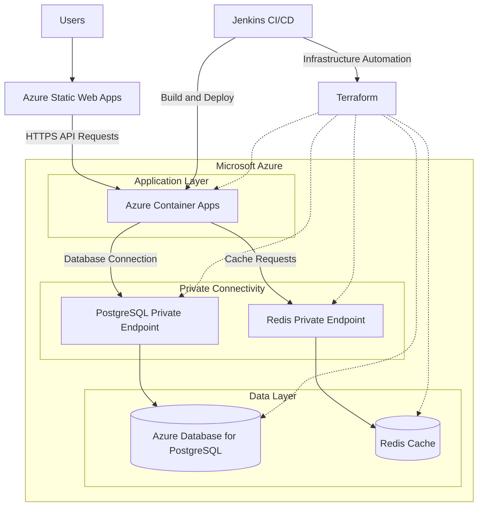

# Three-Tier Azure Application Infrastructure Using Terraform

A cloud-native three-tier application infrastructure deployed on Microsoft Azure using **Terraform, Azure Static Web Apps, Azure Container Apps, Azure Database for PostgreSQL, Redis, Private Endpoints, and Jenkins CI/CD**.

This project demonstrates Infrastructure as Code (IaC), containerized application deployment, cloud networking, secure service connectivity, and automated deployment workflows.

## Architecture

The infrastructure separates the application into presentation, application, and data layers, with caching and network isolation to support a secure and maintainable architecture.



*Note: The diagram illustrates the intended architecture. Actual traffic routing, private endpoint support, DNS configuration, and deployment workflows depend on the resources and configuration in the repository.*

## Technology Stack

| Category | Technology | Purpose |
|---|---|---|
| Cloud platform | Microsoft Azure | Cloud infrastructure and managed services |
| Infrastructure as Code | Terraform | Automated provisioning and management of infrastructure |
| Frontend | Azure Static Web Apps | Hosting the static user interface |
| Application layer | Azure Container Apps | Running containerized backend services |
| Database | Azure Database for PostgreSQL | Persistent relational data storage |
| Caching | Redis | Fast access to frequently requested data |
| Network security | Azure Private Endpoints | Private connectivity to supported services |
| CI/CD | Jenkins | Automating build, validation, and deployment workflows |
| Version control | Git and GitHub | Source code management and collaboration |

## Key Features

### 1. Three-Tier Architecture

The infrastructure separates application responsibilities into three logical layers:

- **Presentation layer:** Delivers the frontend through Azure Static Web Apps.
- **Application layer:** Runs backend application containers using Azure Container Apps.
- **Data layer:** Uses PostgreSQL for persistent storage and Redis for caching.

This separation supports independent management, troubleshooting, and scaling of application components.

### 2. Infrastructure as Code with Terraform

Terraform is used to define and provision Azure infrastructure through declarative configuration.

Benefits include:

- Repeatable infrastructure deployments.
- Version-controlled configuration.
- Consistent resource provisioning.
- Easier infrastructure updates and maintenance.
- A foundation for environment-specific deployments.

### 3. Containerized Application Deployment

Azure Container Apps provides a managed environment for deploying and running containerized backend services.

The application layer can benefit from:

- Managed container execution.
- Configurable scaling.
- Container image-based deployments.
- Integration with Azure networking and identity services.

Actual scaling behavior depends on the configured Container Apps environment, scale rules, and resource settings.

### 4. PostgreSQL Database

Azure Database for PostgreSQL provides relational database capabilities for application data.

The database layer is designed to support:

- Persistent data storage.
- Structured queries and relational data management.
- Backend-to-database communication.
- Network access restrictions based on the deployed configuration.

### 5. Redis Caching

Redis provides an in-memory caching layer to reduce repeated database queries for suitable workloads.

Potential benefits include:

- Lower response latency for cacheable requests.
- Reduced repeated database reads.
- Improved efficiency for frequently accessed data.

The application must implement appropriate cache keys, expiration policies, and invalidation behavior to realize these benefits.

### 6. Private Endpoints and Network Security

Private endpoints provide private IP-based connectivity to supported Azure services through Azure networking.

They help reduce reliance on publicly accessible service endpoints when configured appropriately.

Security considerations include:

- Correct private DNS configuration.
- Appropriate virtual network and subnet design.
- Restricting public network access where supported and required.
- Validating network connectivity from the application environment.
- Managing database credentials and application secrets securely.

**Important:** Creating a private endpoint alone does not guarantee that a service is inaccessible publicly. Public access settings, DNS resolution, network rules, and application connectivity must also be configured and verified.

### 7. Jenkins CI/CD Automation

Jenkins pipeline files provide a foundation for automating infrastructure and application delivery.

A typical pipeline may include:

1. Checkout the source code.
2. Validate Terraform configuration.
3. Generate and review a Terraform execution plan.
4. Provision or update Azure infrastructure when authorized.
5. Build the backend container image.
6. Push the image to a container registry.
7. Deploy the application to Azure Container Apps.
8. Perform deployment verification.

The precise stages depend on the Jenkinsfiles and pipeline configuration in the repository.

## Repository Structure

The repository contains Terraform configuration and Jenkins pipeline files for infrastructure and deployment automation.

An example structure is shown below; adjust it to match the actual files in your repository.

```text
azure-three-tier-infrastructure/
├── frontend/                 # Static frontend application
├── network/                  # Network configuration
├── main.tf                   # Main infrastructure resources
├── provider.tf               # Terraform provider configuration
├── variable.tf               # Input variables
├── output.tf                 # Terraform outputs
├── network.tf                # Networking resources
├── Jenkinsfile               # Jenkins pipeline definition
├── Jenkinsfile.infrastructure # Infrastructure pipeline, if present
├── Jenkinsfile.application   # Application pipeline, if present
├── .terraform.lock.hcl       # Terraform provider lock file
├── .gitignore                # Git exclusions
└── README.md                 # Project documentation
```

*The filenames above are illustrative. Retain only the files and directories that actually exist in your repository.*

## Prerequisites

Before deploying the infrastructure, ensure you have:

- An active Azure subscription.
- Appropriate permissions to create and manage Azure resources.
- [Terraform](https://developer.hashicorp.com/terraform/install).
- [Azure CLI](https://learn.microsoft.com/en-us/cli/azure/install-azure-cli).
- [Docker](https://docs.docker.com/get-started/get-docker/) for container image workflows.
- [Jenkins](https://www.jenkins.io/doc/) configured with the required pipeline tools and permissions.
- A Git repository containing the application and infrastructure code.

Depending on the implementation, you may also need an Azure Container Registry or another container registry.

## Deployment Workflow

### Step 1: Clone the repository

```bash
git clone <YOUR_REPOSITORY_URL>
cd <YOUR_REPOSITORY_DIRECTORY>
```

Replace the placeholders with your repository URL and directory name.

### Step 2: Authenticate with Azure

```bash
az login
```

If multiple subscriptions are available, select the intended subscription:

```bash
az account list --output table
az account set --subscription "<YOUR_SUBSCRIPTION_ID>"
```

Verify the active subscription:

```bash
az account show --output table
```

### Step 3: Initialize Terraform

Run the following command from the directory containing the Terraform root configuration:

```bash
terraform init
```

### Step 4: Validate the configuration

```bash
terraform fmt -check
terraform validate
```

### Step 5: Review infrastructure changes

```bash
terraform plan
```

Inspect the proposed resource changes before applying them.

### Step 6: Provision the infrastructure

```bash
terraform apply
```

Review and approve the plan when prompted.

Supply any required input variables using the method supported by the repository.

### Step 7: Configure and execute Jenkins

Configure Jenkins with the required source repository, build tools, Azure authentication, registry access, and pipeline parameters.

Run the appropriate pipeline to perform the configured build, infrastructure, or deployment stages.

Use Jenkins credentials management or an appropriate Azure identity integration rather than hardcoding credentials in pipeline files.

### Step 8: Verify the deployment

After deployment, verify that:

- The frontend loads successfully.
- The backend API responds as expected.
- The backend can connect to PostgreSQL.
- Redis connectivity and caching behavior work as intended.
- Private DNS resolves the intended private endpoints.
- Network access follows the expected security configuration.
- Jenkins reports successful execution of the configured stages.

## Security Best Practices

Security is a core consideration for cloud infrastructure.

Recommended practices include:

- Use managed identities where supported.
- Store secrets in Azure Key Vault or Jenkins credentials management.
- Avoid committing credentials, access tokens, or database passwords to Git.
- Restrict PostgreSQL and Redis access to authorized application components.
- Configure private endpoints and DNS deliberately.
- Disable public network access where supported and appropriate.
- Apply least-privilege access to Azure resources and Jenkins.
- Protect Terraform state because it may contain sensitive information.
- Review container images and dependencies for vulnerabilities.
- Require appropriate review and authorization before production deployments.

These are recommended practices and should not be interpreted as confirmation that every control is already implemented.

## Cost Management

Azure Container Apps, PostgreSQL, Redis, networking resources, and related services may incur charges.

To manage costs:

- Select resource tiers appropriate for your workload.
- Review pricing before creating managed database and cache resources.
- Monitor spending through Azure Cost Management.
- Remove unused resources when testing is complete.
- Review the cost implications of private endpoints and associated networking resources.

## Future Enhancements

Potential improvements include:

- [ ] Configure remote Terraform state using Azure Storage.
- [ ] Introduce reusable Terraform modules.
- [ ] Separate development, staging, and production environments.
- [ ] Implement automated Terraform validation in Jenkins.
- [ ] Add container image vulnerability scanning.
- [ ] Integrate Azure Key Vault with application deployment.
- [ ] Configure monitoring, logging, and alerting.
- [ ] Add deployment health checks and rollback procedures.
- [ ] Implement backup and recovery procedures for PostgreSQL.
- [ ] Document private DNS and network connectivity testing.
- [ ] Add automated application and infrastructure tests.

## Learning Outcomes

This project demonstrates practical work with:

- Azure cloud architecture.
- Terraform-based infrastructure automation.
- Containerized application deployment.
- PostgreSQL and Redis integration.
- Private networking and endpoint configuration.
- Jenkins pipeline automation.
- Cloud security and identity management.
- Infrastructure lifecycle and cost management.

## Contributing

Contributions and suggestions are welcome.

1. Fork the repository.
2. Create a branch for your changes.
3. Make and validate your changes.
4. Submit a pull request explaining the improvement.

Please ensure that no credentials or sensitive configuration files are included in commits.

## Author

**Yashini Pardeshi**

- GitHub: [@Yashini13](https://github.com/Yashini13)

## License

Add a license to the repository if you intend to allow others to reuse, modify, and distribute the project. Until a license is included, reuse is subject to the applicable copyright rules.

---

**Project focus:** Three-tier Azure infrastructure, Infrastructure as Code, private connectivity, managed data services, and Jenkins-based deployment automation.
